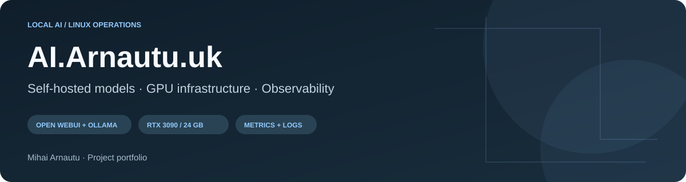
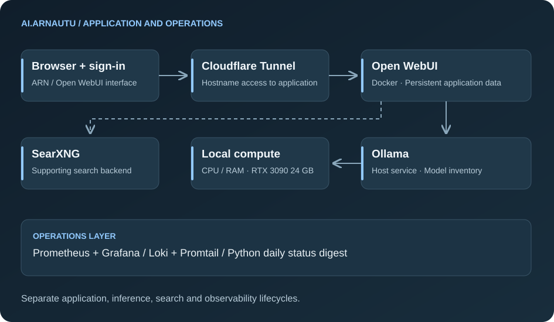

# AI.Arnautu.uk — Self-Hosted AI and Linux Infrastructure

**[Application endpoint](https://ai.arnautu.uk/) · [Commit history](https://github.com/mihai-arnautu/ai-arnautu/commits/main/) · [Activity](https://github.com/mihai-arnautu/ai-arnautu/activity)**

A self-hosted AI environment branded **ARN**, combining Open WebUI, Ollama and local compute with search, observability and scheduled maintenance. This case study covers how the application and its supporting infrastructure fit together, including the operational work beyond the browser interface.

## At a glance

| Area | Implementation |
| --- | --- |
| User interface | Open WebUI with sign-in and custom mounted branding |
| Inference backend | Ollama as a Linux systemd service |
| Compute | Ryzen 7 9700X, approximately 60 GiB usable RAM and RTX 3090 with 24 GB VRAM |
| Model management | Qwen general-use and coding variants at different sizes/quantizations |
| Supporting services | SearXNG, persistent application storage and Cloudflare Tunnel |
| Observability | Prometheus, Grafana, Loki, Promtail, node-exporter and cAdvisor |
| Automation | Python status digest, systemd timers and interface/backend update workflows |

## The problem and the result

Operating a local AI environment involves more than installing a chat interface. The model runtime needs enough memory, the application needs persistent data, remote access needs routing, and failures need useful signals.

This deployment connects those layers on one Linux host. It provides a browser entry point to a configurable local model runtime and a supporting operations stack for inspecting resources, logs, model changes and scheduled jobs.

## My role

| Workstream | Contribution |
| --- | --- |
| Application deployment | Configured Open WebUI containers, persistent storage and custom branding |
| Model backend | Configured Ollama service units, local/trusted-network access and model inventory |
| GPU operation | Maintained the NVIDIA environment and investigated driver/kernel compatibility issues |
| Search and access | Integrated the SearXNG backend and configured the public hostname through a tunnel |
| Observability | Operated metrics/log collection, provisioned dashboards and host alert definitions |
| Automation | Maintained daily reporting, state comparisons, scheduled updates and backup-related checks |

The underlying applications and models are upstream software. My contribution is deploying, integrating, configuring and operating them, rather than authorship of Open WebUI, Ollama or the Qwen models.

## Architecture

Open WebUI runs in Docker and connects to the host's Ollama service. Model artifacts and GPU runtime state are separate from application data. Search, metrics, logs and reporting remain distinct responsibilities so they can be checked independently.

**[Explore the component and data-flow design →](docs/architecture.md)**

## Engineering and operations highlights

### Model capacity is a deployment decision

The installed library includes 17 GB, 23 GB, 51 GB and 84 GB reported artifacts, while the GPU has 24 GB VRAM. Selecting a model therefore requires distinguishing installation size from runtime memory and deciding how to use host/GPU resources. The portfolio documents that tradeoff without claiming that every model fits entirely on the GPU.

### Observe the backend, not only the sign-in page

Provisioned dashboards cover Ollama request logs, runner/model events and errors, alongside host and container logs. Alert definitions cover missing exporters, disk pressure, memory pressure, CPU load and a read-only root filesystem.

### Compare changes in the daily report

A Python digest combines metrics, service/container status, versions, installed/loaded models and backup-related checks. It compares the current result with the previous successful snapshot, highlighting changes instead of only repeating an inventory.

### Keep recovery evidence specific

The operational history includes a GPU driver/kernel compatibility incident and a network-dependent backup mount recovery. These are documented with the affected layer and the limits of each successful check, rather than treating one healthy service as proof of the whole system.

**[Read the observability, automation and recovery notes →](docs/operations.md)**

## Hardware and model management

| Topic | Practical detail |
| --- | --- |
| CPU | 8 cores and 16 logical CPUs |
| GPU | RTX 3090, 24 GB VRAM |
| Model variants | General-use, locally named VS Code-oriented and coding entries |
| Quantization | Smaller and larger coding artifacts offer different storage/memory tradeoffs |
| Configuration tracking | Service units, update logic, inventory and manifests |
| Artifact storage | Large weights and GPU cache kept outside Git |

**[Read the inventory and resource analysis →](docs/models-and-hardware.md)**

## Visitor-facing interface

This image was captured without signing in. It shows the public entry point; private conversations and administrative screens are intentionally absent. The architecture diagrams explain the infrastructure that cannot be seen from a sign-in page.

## Technical dossier

| Page | Details |
| --- | --- |
| [Platform architecture](docs/architecture.md) | Component responsibilities, data categories and request/failure boundaries |
| [Models and hardware](docs/models-and-hardware.md) | Observed hardware, local inventory, capacity tradeoffs and model lifecycle |
| [Operations](docs/operations.md) | Dashboards, eight alert definitions, reporting, update automation and recovery |
| [History and validation](docs/history-and-validation.md) | Original source milestones, current checks, lessons and follow-up work |

## Development milestones

| Period | Recorded work |
| --- | --- |
| December 2025 | Initial metrics monitoring and SMTP integration |
| March 2026 | Interface/backend configuration repositories and expanded log collection |
| April 2026 | Status reporting, scheduled updates and SearXNG integration |
| Later maintenance | Network/storage and GPU compatibility work; refreshed model inventory |
| November 2026 | Current platform inspection and this consolidated technical case study |

The [full timeline](docs/history-and-validation.md#a-deployment-assembled-over-time) references real source revisions. The [portfolio commit history](https://github.com/mihai-arnautu/ai-arnautu/commits/main/) records documentation updates from November onward. Explore the [repository activity](https://github.com/mihai-arnautu/ai-arnautu/activity) and [commit activity chart](https://github.com/mihai-arnautu/ai-arnautu/graphs/commit-activity) for the actual history of this presentation.

## Verification and scope

The inspection confirmed a serving public endpoint, the ARN sign-in screen, a healthy Open WebUI container, an active Ollama service, running supporting containers, the GPU/model inventory and active maintenance/report/backup timers. No inference benchmark or full restore test was performed for this presentation update.

The model runtime is self-hosted; search, tunnel access, downloads and mail involve external services. This is not a claim that every feature works offline or that all possible integrations process data locally.

This repository contains documentation and approved public-view screenshots, with no credentials, private configuration, internal addresses or chat histories. Visitors have no push access. The stack credits [Open WebUI](https://github.com/open-webui/open-webui), [Ollama](https://github.com/ollama/ollama), [SearXNG](https://github.com/searxng/searxng), [Prometheus](https://prometheus.io/), [Grafana](https://grafana.com/) and [Cloudflare](https://www.cloudflare.com/).

**Related project:** [Veterom.ro — Bilingual Clinic Website](https://github.com/mihai-arnautu/veterom)
