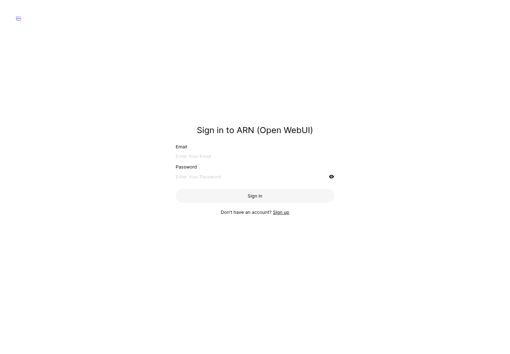
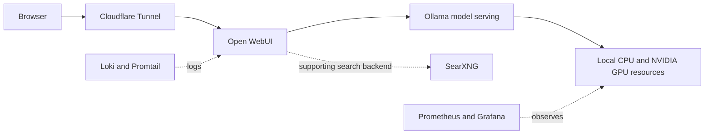

# AI.Arnautu.uk

A self-hosted AI environment combining a browser interface, local language model serving and Linux infrastructure.

**Application endpoint:** [ai.arnautu.uk](https://ai.arnautu.uk/)

## Purpose

Run and maintain an AI environment on my own infrastructure, with a browser interface for interacting with locally hosted models and supporting services for search and observability.

## My contribution

- Deployed and configured Open WebUI and Ollama on a Linux host.
- Managed the local model library and NVIDIA GPU environment.
- Customized interface branding through mounted image assets.
- Operated Docker services and persistent application storage.
- Deployed SearXNG as a supporting search backend.
- Configured the public hostname through Cloudflare Tunnel.
- Operated monitoring and logging services supporting the host and containers.

Open WebUI provides the application interface and Ollama provides model serving. My work is the deployment, integration, customization and operation of these components.

## Architecture

## Technology and infrastructure

| Area | Components |
| --- | --- |
| AI interface | Open WebUI |
| Model serving | Ollama |
| GPU | NVIDIA GeForce RTX 3090, 24 GB VRAM |
| Containers | Docker and Compose |
| Host services | Linux and systemd |
| Public access | Cloudflare Tunnel and custom hostname |
| Supporting search | SearXNG |
| Metrics | Prometheus, node-exporter, cAdvisor and Grafana |
| Logs | Loki and Promtail |

## Model management

The installed model library includes Qwen models for general and coding use. At the November 2026 inspection, it included Qwen 3.8 27B, Qwen 3.6 35B and quantized Qwen3-Coder-Next variants.

Installed models are not necessarily running at the same time. Memory requirements differ by model and quantization; the model inventory does not imply that every model fits entirely in GPU memory. No throughput or latency benchmark is claimed here.

## Operational work

**Persistent storage.** Application data is stored in a Docker volume, with branding assets mounted separately from the application image.

**Separation of services.** The interface, search backend and monitoring tools run as distinct services. Ollama runs as a host service.

**Observability.** Host and container metrics support troubleshooting and capacity checks; the logging stack collects system and container logs.

**Maintenance.** Work includes service health checks, model updates, GPU driver maintenance and validation after infrastructure changes.

## Verification

During the November 2026 inspection, the public endpoint returned HTTP 200, Open WebUI reported healthy, and the supporting search and monitoring containers were running. The GPU and installed model inventory were checked locally.

This confirms deployment state at inspection time, rather than a published uptime guarantee or an inference benchmark. The endpoint is an application, not a promise of unrestricted anonymous access.

## Project boundaries

This repository documents the deployment. It contains no chat histories, account data, credentials, private network addresses or runnable copies of private infrastructure configuration. No claim is made that all possible application features or connected services process data locally.

Built on [Open WebUI](https://github.com/open-webui/open-webui), [Ollama](https://github.com/ollama/ollama), [SearXNG](https://github.com/searxng/searxng), [Prometheus](https://prometheus.io/), [Grafana](https://grafana.com/) and [Cloudflare Tunnel](https://developers.cloudflare.com/cloudflare-one/networks/connectors/cloudflare-tunnel/).
