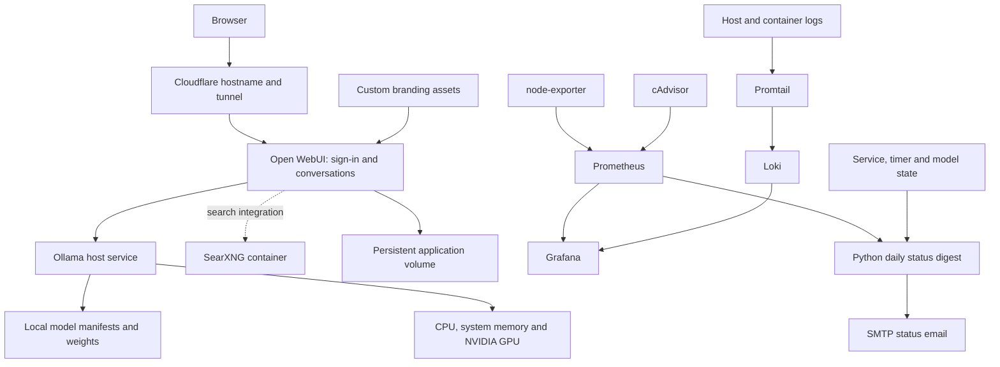

# Platform architecture

[← Project overview](../README.md) · [Models and hardware](models-and-hardware.md) · [Operations](operations.md)

## A browser interface backed by local model serving

AI.Arnautu.uk combines upstream applications with host-level services. Open WebUI supplies the user interface; Ollama runs model inference. Docker packages the interface and supporting services, while systemd manages the host backend and scheduled maintenance.

The deployment work lies in connecting these components, maintaining their data and lifecycle, and making failures observable. The underlying model architectures and upstream applications are credited to their respective projects.

Solid lines describe configured responsibilities and data paths. Search availability still depends on application settings and individual requests; a running search container alone does not prove that every conversation uses web search.

## Component responsibilities

| Component | Responsibility | Deployment choice |
| --- | --- | --- |
| Open WebUI | Sign-in, browser interaction and model interface | Docker container with persistent volume |
| Ollama | Model inventory, loading and inference API | Host systemd service |
| NVIDIA runtime | GPU availability to model serving | Host driver and GPU stack |
| SearXNG | Search backend for the interface integration | Separate container, loopback-bound endpoint |
| Cloudflare Tunnel | Hostname routing to the application | Host service for the AI route |
| Watchtower | Scheduled Open WebUI image update checks | Separate update container |
| Prometheus | Time-series metrics | Docker service |
| node-exporter / cAdvisor | Host / container metrics | Dedicated exporters |
| Loki / Promtail | Log storage / collection | Dedicated services |
| Grafana | Metrics and log exploration; provisioned alert definitions | Docker service with persistent state |
| Daily digest | Consolidated status and change reporting | Python script and systemd timer |

## Why Ollama runs on the host

The configuration keeps model serving under systemd, alongside host GPU driver management. Open WebUI uses host networking to connect to the local backend. This separates the lifecycle of the browser application image from the backend process and model files.

The tradeoff is that deployment knowledge spans both Compose and systemd. A healthy Docker stack does not by itself prove that the host backend or GPU is ready.

## Persistent data and rebuildable components

| Category | Treatment |
| --- | --- |
| Application accounts and conversation state | Persistent Open WebUI volume |
| Branding | Separate mounted image assets |
| Model manifests and inventory | Small metadata suitable for configuration tracking |
| Model weights | Large local artifacts; not committed to source control |
| GPU runtime cache | Transient runtime data; not a source artifact |
| Metrics, logs and dashboards | Monitoring configuration separated from runtime volumes |
| Credentials and report recipients | Private configuration outside this case study |

Model files can be downloaded again from their upstream source. Application data and configuration have different recovery requirements, so they should not be treated as one interchangeable backup category.

## Request and failure boundaries

| Symptom | Relevant layer to check |
| --- | --- |
| Public page unreachable | DNS, tunnel and application availability |
| Sign-in page works but inference fails | Ollama service, model availability and compute resources |
| One model fails to load | Model metadata, disk space and memory requirements |
| Search unavailable | SearXNG and application search settings |
| Missing metrics | Exporter health and Prometheus targets |
| Missing logs | Promtail collection and Loki ingestion |
| No daily report | Timer/service state and SMTP delivery path |

## Access and deployment boundaries

The public endpoint presents a sign-in interface branded **ARN (Open WebUI)**. It does not expose private chat histories in this portfolio. The Ollama backend is configured for local/trusted-network use rather than being presented here as a public model API.

The monitoring deployment includes host-published services. This documentation does not claim that all monitoring endpoints are private or comprehensively hardened; access control and firewall review remain operational responsibilities.

Local model serving is one part of the system. Web search, hostname access, update downloads, email and any additional configured integrations involve external services. The project is therefore described as self-hosted model serving, rather than a claim that every feature is fully offline.
