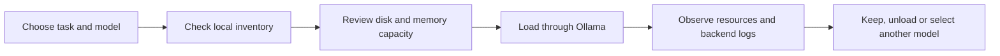

# Hardware, models and resource decisions

[← Project overview](../README.md) · [Architecture](architecture.md) · [Operations](operations.md)

## Observed hardware

The following is an inspection snapshot from 2 November 2026, not a performance benchmark.

| Resource | Observed configuration |
| --- | --- |
| Processor | AMD Ryzen 7 9700X |
| CPU topology | 8 physical cores, 16 logical CPUs |
| System memory | Approximately 60 GiB usable, as reported by the OS |
| GPU | NVIDIA GeForce RTX 3090 |
| GPU memory | 24 GB |
| Root filesystem | Approximately 913 GiB, ext4 on LVM |
| Runtime | Ollama host service with Docker-hosted application and supporting services |

The root filesystem is shared with other host workloads. Its total capacity is not a measurement of available model storage or a dedicated AI disk.

## Installed model inventory

| Local model tag | Reported artifact size | Interpretation |
| --- | --- | --- |
| `qwen3.8:27b` | 17 GB | General-use model entry |
| `qwen3.8-vscode:27b` | 17 GB | Locally named VS Code-oriented entry |
| `qwen3.6:35b` | 23 GB | Additional general-use model entry |
| `qwen3-coder-next:q4_K_M` | 51 GB | Coding model with lower-precision quantization |
| `qwen3-coder-next:q8_0` | 84 GB | Coding model with a larger quantized artifact |

These are local inventory tags and sizes returned by Ollama. A custom tag is not evidence of model training, and the table does not claim that all models are active, independently stored without shared layers, or currently selected in the interface.

## Three different resource questions

**Is the model installed?** Inventory and manifests show that the artifact is available locally. This is a storage question.

**Can it load for the intended task?** Model size, context length, runtime buffers, GPU VRAM and system memory determine whether it can be loaded usefully. This is a capacity question.

**Does it respond at an acceptable speed?** Prompt length, output length, offloading and competing workloads affect latency and throughput. This requires measurement; it cannot be derived from an installed-model list.

## Quantization and the 24 GB GPU

The model library deliberately includes different sizes and quantizations. The coding artifacts are larger than the GPU's VRAM, so the inventory should not be described as five models that all run entirely on the GPU.

Runtime memory can exceed the artifact size because inference also needs working buffers and context-related memory. CPU/GPU offloading can change whether a model is usable, but it also changes latency. For this portfolio, GPU-backed serving describes the available infrastructure rather than a claim that every request is fully GPU-resident.

## Model lifecycle

Configuration tracking includes service units, update logic, inventory and model manifests. Large weight blobs and GPU cache files remain outside Git. This keeps the configuration history useful without turning it into a storage mirror.

## Maintenance details

- Ollama update checks are scheduled with a systemd timer and a dedicated update script.
- Logs have a rotation policy instead of growing without an explicit retention mechanism.
- The update history includes a correction to version parsing, showing that maintenance automation itself needs validation.
- Backend service state, installed models and loaded models are distinct inputs to the daily status report.

## Measurements worth adding next

A useful benchmark would fix the exact model tag, prompt, output length, context size, cold/warm state and offloading configuration, then report repeated latency and token-throughput measurements alongside memory use.

No such benchmark was run for this documentation update. The portfolio avoids replacing that missing evidence with a throughput estimate or an invented comparison against hosted AI services.
