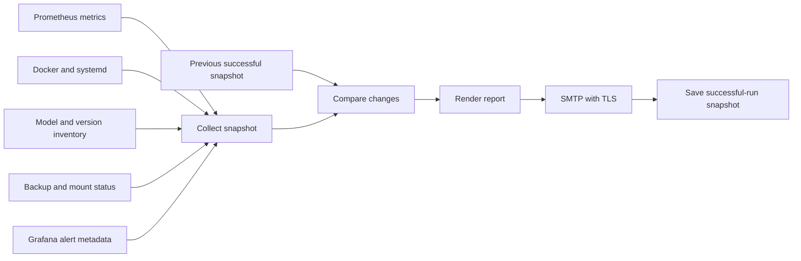

# Observability, automation and recovery

[← Project overview](../README.md) · [Architecture](architecture.md) · [Development history](history-and-validation.md)

## Monitor several layers, not just the web page

A responding sign-in page does not prove that a model can load. A running model process does not prove that log collection or backup scheduling works. The deployment combines host metrics, container state, service checks and logs so those conditions can be investigated separately.

| Layer | Signal source | Use |
| --- | --- | --- |
| Host | node-exporter and systemd | CPU, memory, disk and service state |
| Containers | cAdvisor and Docker metadata | Container resource use, image and health state |
| Metrics pipeline | Prometheus target status | Identify missing or failing scrapes |
| Application/backend logs | Promtail and Loki | Investigate requests, model events and errors |
| Model inventory | Ollama | Distinguish installed and loaded models |
| Schedules | systemd timers | Track maintenance and report jobs |
| Backup paths | Mount and Borg checks in the reporting script | Detect storage and repository availability problems |

## Provisioned dashboards

The monitoring configuration contains two named dashboards relevant to this project:

| Dashboard | Panels and purpose |
| --- | --- |
| **Ollama Backend** | Request rate, runner/model events, request logs, backend events and errors |
| **Host Logs Overview** | Container log rate, Docker logs, Ollama backend logs and system logs |

The request-rate panels derive information from matching log lines. They should not be described as a direct measurement of generated tokens per second.

## Alert definitions

The provisioned host alerts cover both resource pressure and missing telemetry:

| Definition | Configured condition |
| --- | --- |
| Node Exporter Down | Missing exporter response for more than 2 minutes |
| Prometheus Target Down | Missing self-scrape confirmation for more than 2 minutes |
| cAdvisor Target Down | Container metrics missing for more than 5 minutes |
| Root Disk Usage High | Above 85% for 10 minutes |
| Root Disk Usage Critical | Above 95% for 5 minutes |
| Memory Pressure Critical | Above 95% for 10 minutes |
| CPU Usage Critical | Above 90% for 15 minutes |
| Root Filesystem Read Only | Root filesystem reports a read-only state |

These values were read from the provisioned definitions. They are not evidence that every alert channel was triggered and its notification received during this inspection.

## Daily status digest

A Python script consolidates several sources into a scheduled email report. Its implementation collects Prometheus values, Docker/systemd state, timer metadata, application versions, installed/loaded models and backup-related status. Alert metadata is read from the local Grafana database.

The previous snapshot lets the report highlight changes rather than only repeat a current inventory. Tracked differences include versions, model lists, container images/status and alert state. A dry-run option previews reporting without sending mail or updating state.

The report timer was active at inspection time and scheduled around 09:00 local time. A scheduled timer is not proof that a recipient received a particular report.

## Backup design and current evidence

The host configuration includes a daily NAS backup timer and a weekly Borg backup workflow with an S3-related storage path. Backup scripts, mount availability, repository accessibility and restore testing are separate concerns.

Both backup timers were active and had scheduled future runs when inspected in November. Earlier recovery notes record a NAS-address change that broke an existing mount, followed by mount correction and a successful Borg repository-open check.

The case study does not claim a new full backup, successful off-site copy or complete restore test from timer state alone. The operational lesson is to inspect the repository and test recovery, rather than assuming that a schedule implies recoverable data.

## Maintenance and recovery examples

**GPU driver/kernel compatibility.** A recorded recovery involved a kernel transition and an NVIDIA module build failure. The diagnosis separated the driver/module problem from the bootloader. Driver compatibility and a known-good kernel were part of the recovery path; rebooting remained a deliberate user-controlled operation.

**Network-dependent storage.** A NAS address change left backup access pointing at the wrong destination. Correcting the mount and checking Borg addressed the storage path, while a separate scheduler problem still required its own recovery. Restoring one layer did not establish the health of the whole pipeline.

**Update automation.** Open WebUI has a scheduled image-update service, while Ollama has host-level update automation. The current configuration uses moving image tags, so image pinning and a more explicit staged-update policy are worthwhile follow-up improvements.

## Practical check order

1. Check the application endpoint and the affected container/service.
2. Check the dependency immediately behind it: model runtime, search or storage.
3. Correlate logs with CPU, memory and disk state.
4. Check recent image, package, model or configuration changes.
5. Validate the affected function after recovery; do not use one healthy status as evidence for unrelated functions.

No private logs, report recipients, account data or credential-bearing configuration are distributed with this portfolio.
